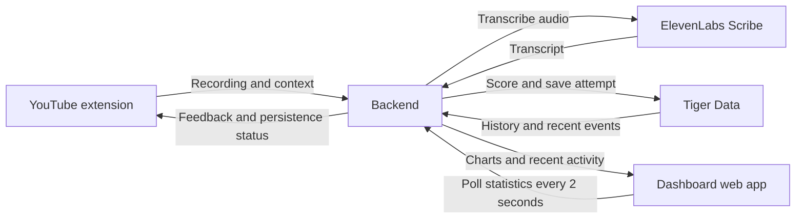

# Dashboard Integration Plan

## Goal and current status

The dashboard shows progress from activity in the YouTube extension. The main demo moment is a real speaking attempt appearing in the dashboard within 1-2 seconds after the backend saves it.

At the time of this plan, the extension is built and installed in Chrome, with caption extraction and console logging. No backend or dashboard implementation was found. The contracts below are proposals for the team to agree on, not working endpoints.

Start with one demo user, English-to-Spanish, and one video with clean captions. Accounts and authentication are outside the first milestone. Keep a demo without authentication restricted to local development; review access controls before exposing it publicly.

## Architecture



- The extension and dashboard share one backend and demo user ID.
- Provider keys and database credentials stay in the backend.
- The dashboard never connects directly to Tiger Data.
- The backend owns scoring orchestration, event persistence, and statistics queries.
- Polling is sufficient for the first version. WebSockets can wait.

## Four-person ownership

| Person | Owns | Integration responsibility |
| --- | --- | --- |
| A: extension | `extension/` | Capture audio and attempt context; display feedback; send lookup/watch/save events according to agreed ownership |
| B: AI + audio | Provider and scoring modules in the backend | Gemini, ElevenLabs TTS/Scribe, transcript normalization, scoring, per-word results |
| C: backend + data | Server, routes, migrations, data queries | Integrate B's modules; persist events; publish statistics APIs; handle keys, caching, and backend configuration |
| D: dashboard + demo | Proposed `dashboard/` folder | Dashboard components, charts, polling, connection states, integration rehearsal, and demo assets |

B and C should choose separate backend files before coding. C owns shared server wiring; B supplies functions called by those routes.

## Dashboard MVP

| Section | Shows | Endpoint |
| --- | --- | --- |
| Latest attempt | Target phrase, recognized transcript, score, missed words, timestamp | `GET /stats/recent` |
| Progress chart | Daily average intelligibility score and attempt count | `GET /stats/score-trend` |
| Activity summary | Practice attempts, phrase lookups, saved vocabulary, watched minutes | `GET /stats/activity` |

The latest-attempt card is the main live demo feature. A single attempt may barely change a daily average, so do not rely on the trend chart to prove that the integration works.

Optional after the MVP:

- Trouble words, derived from per-word scoring results.
- Saved vocabulary and pronunciation practice buttons.
- Study heatmap.
- Top videos by vocabulary saved.

Use "intelligibility score" in the UI. Speech transcription compared with target text does not measure phonetic accent accuracy. Label vocabulary as saved or practiced rather than claiming that saving proves mastery.

## First team decisions

- [ ] Choose backend language and dashboard framework. The existing specs allow FastAPI or Node, and Next.js or Vite + React.
- [ ] Choose the backend base URL and dashboard origin for local development.
- [ ] Use `demo-user` in both clients initially.
- [ ] Use score values from `0` to `1` in APIs; format them as percentages in the UI.
- [ ] Store timestamps in UTC; group daily statistics in one agreed timezone, initially `America/New_York`.
- [ ] Agree on the per-word result format, including expected and recognized tokens.
- [ ] Agree that `/stt` saves shadowing attempts. The extension must not also submit them to `/events`.
- [ ] Agree on retry behavior and how persistence failure appears in both clients.
- [ ] Add stable event/attempt identifiers and synthetic-data labels to the original data model.

## Proposed recording contract

This extends the original `/stt` draft, which only specified audio and target text. Agree on the additions before implementation.

### Request: `POST /stt`

Use multipart form data. Let the browser set the multipart boundary.

| Field | Type | Purpose |
| --- | --- | --- |
| `audio` | File | Recording in a format B has confirmed Scribe accepts |
| `target_text` | String | Frozen target-language line for this attempt |
| `attempt_id` | UUID string | Generated once by the extension; retained on retry |
| `user_id` | String | Shared demo user ID |
| `video_id` | String | YouTube video identifier |
| `video_ts` | Number encoded as text | Target line's video timestamp in seconds |
| `lang` | String | Target language, initially `es` |

### Successful response: `200`

```json
{
  "attempt_id": "9b7d5402-4d48-4a38-8c10-52a863dc766b",
  "transcript": "como estas",
  "score": 1.0,
  "words": [
    { "word": "cómo", "heard": "como", "status": "correct" },
    { "word": "estás", "heard": "estas", "status": "correct" }
  ],
  "event_saved": true,
  "saved_at": "2026-10-10T14:00:00Z"
}
```

This example assumes B's scoring normalizes accents. Allowed statuses initially: `correct`, `missed`, and `substituted`; `heard` is null for a missed target word. B must also define how extra recognized words affect the score. Do not silently change scoring between the extension and dashboard.

### Backend sequence

1. Validate input and recording limits.
2. Check whether this user's `attempt_id` already completed. If so, return its stored result without creating another event or calling Scribe again.
3. Transcribe through B's Scribe module.
4. Score against the target text using B's scoring function.
5. Persist the result and a single `shadow_attempt` event.
6. Return the score with persistence status.

The idempotency check must also handle concurrent duplicate requests. A read-before-write check alone is insufficient; C should use a database uniqueness constraint and an atomic claim/write strategy.

Suggested approach: a relational `shadow_attempts` table keyed by `(user_id, attempt_id)` for request state/results, plus the existing `learning_events` hypertable for time-series events. Update the completed attempt and write its event in one transaction. A UUID-only unique index on a time-partitioned hypertable is not a sufficient proposed design; C must account for its partition-key constraints.

### Failure behavior

- Invalid input: `400` with a stable error code and readable message.
- Unsupported audio format: `415`.
- An identical attempt is still processing: `409` with `ATTEMPT_PROCESSING`; retry the same ID after the indicated delay.
- Transcription/provider failure: return an error, keep the same ID for retry, and create no successful event.
- Scoring succeeded but persistence failed: return the score with `event_saved: false` and `saved_at: null`. The extension may display feedback, but must show that progress was not saved. No live dashboard appearance is expected until persistence succeeds.

Retrying the same ID must not create duplicate completed events. Avoid promising that a retry will also avoid another paid provider call unless the intermediate result was retained.

## Stored shadowing event

Extend the original event schema with `event_id` and `is_synthetic`, with database constraints/migrations owned by C. For a shadowing event, use the attempt UUID as its event ID.

```json
{
  "event_id": "9b7d5402-4d48-4a38-8c10-52a863dc766b",
  "time": "2026-10-10T14:00:00Z",
  "user_id": "demo-user",
  "event_type": "shadow_attempt",
  "video_id": "demo-video-id",
  "lang": "es",
  "score": 1.0,
  "is_synthetic": false,
  "meta": {
    "target_text": "¿cómo estás?",
    "transcript": "como estas",
    "video_ts": 12.4,
    "words": [
      { "word": "cómo", "heard": "como", "status": "correct" },
      { "word": "estás", "heard": "estas", "status": "correct" }
    ]
  }
}
```

Keep raw recordings out of this event payload. Recording retention, if needed, is a separate decision.

## Proposed dashboard read contracts

All endpoints filter by the requested user. A demo user ID is not authentication; C must not treat this query parameter as proof of identity if accounts are added later.

### Recent events

Initial request: `GET /stats/recent?user_id=demo-user&limit=20`

```json
{
  "events": [],
  "cursor": "opaque-server-cursor",
  "has_more": false
}
```

Subsequent request: `GET /stats/recent?user_id=demo-user&cursor=opaque-server-cursor&limit=20`

- Return events in ascending cursor order; the client renders latest first.
- Each event includes its stable ID, timestamp, type, synthetic flag, and relevant metadata.
- Treat the cursor as opaque on the client. C must define an ordering that does not lose events committed late; wall-clock timestamps alone are insufficient.
- An initial response should include the latest 20 events and a cursor for changes after that snapshot.
- Retain the previous cursor when no new events arrive.
- Drain additional pages when `has_more` is true before waiting for the next regular poll.
- Read recent events directly from persisted event/attempt data rather than waiting for continuous aggregates.

### Daily score trend

`GET /stats/score-trend?user_id=demo-user&days=7`

```json
{
  "timezone": "America/New_York",
  "points": [
    { "day": "2026-10-10", "avg_score": 0.82, "attempts": 5 }
  ],
  "includes_synthetic": false
}
```

Only count completed, persisted shadowing attempts. Use null, rather than zero, for a day with no attempts. Use raw data for the current day initially; if C adds continuous aggregates for history, combine ranges without overlapping or double-counting.

### Daily activity

`GET /stats/activity?user_id=demo-user&days=7`

```json
{
  "timezone": "America/New_York",
  "points": [
    {
      "day": "2026-10-10",
      "shadow_attempts": 5,
      "lookups": 12,
      "vocab_saved": 3,
      "watched_minutes": 8
    }
  ],
  "includes_synthetic": false
}
```

Define watched time explicitly. Page loads and caption loads are not minutes watched. A should report actual active playback duration through agreed `caption_view` metadata; C sums the duration and converts seconds to minutes.

### Optional trouble words

`GET /stats/trouble-words?user_id=demo-user&limit=10`

Proposed response: `{ "words": [{ "word": "estás", "attempts": 4, "misses": 2, "miss_rate": 0.5 }] }`.

This intentionally revises the original draft's `avg_score`: derive difficulty from per-word outcomes rather than copying an entire sentence score to each word. Group by user, language, and normalized word; retain display text.

## Polling and UI behavior

1. On first load, fetch recent events, score trend, and activity independently.
2. Poll recent events every 2 seconds after the previous request finishes. Do not allow overlapping polls.
3. Deduplicate events by event ID, retain the returned cursor, and keep the displayed recent list bounded.
4. When a new shadowing attempt arrives, update the latest-attempt card and refetch score/activity statistics.
5. Refetch activity after relevant non-shadowing events and periodically refresh statistics so lookup-only activity does not stay stale.
6. On failure, retain existing data, mark it as stale, and back off retries. Resume the normal interval after success.
7. Pause polling in a hidden tab and refresh when it becomes visible.
8. Clear timers and abort requests on component unmount or demo-user changes. Disregard stale responses for a previous user.

States to support: loading, connected, empty, reconnecting/stale, and unrecoverable error. Distinguish genuinely empty data from a failed request. Render provider text as text, not raw HTML.

Label synthetic seed history and synthetic attempts clearly. Preserve the distinction when seed and live events appear in the same chart or list.

## Local integration setup

Proposed folders under `knighthacksix/`:

```text
extension/    # Existing Chrome extension
backend/      # Proposed shared server, provider modules, and database code
dashboard/    # Proposed web app
docs/         # Contracts and build checklists
```

- C chooses the backend port; D configures the dashboard API base URL to match.
- C allows the dashboard's exact development origin through backend CORS.
- A adds the backend origin to extension host permissions and routes API calls through the background worker. Confirm browser/backend behavior with the actual local origins.
- Dashboard frontend configuration contains only the API base URL and demo settings, never Gemini, ElevenLabs, or database keys.
- Do not inspect, print, or copy secret values into this plan, screenshots, logs, or frontend code.
- Localhost URLs only work while the required processes run on that computer. A remote dashboard cannot connect to another person's localhost backend; coordinate accessible URLs before a hosted demo.

## Person C: backend checklist

- [ ] Agree on the contracts above with A, B, and D.
- [ ] Scaffold the server and publish mock responses for `/stt` and the three MVP statistics routes.
- [ ] Provide the backend URL and configure local access/CORS.
- [ ] Create migrations for users, attempts, and learning events.
- [ ] Seed `demo-user` and add clearly marked synthetic history.
- [ ] Implement idempotent attempt processing and transactional event persistence.
- [ ] Wire B's transcription and scoring modules into `/stt`.
- [ ] Implement recent-event pagination/cursors and current-day queries.
- [ ] Implement score-trend and activity queries with agreed timezone boundaries.
- [ ] Verify a stored attempt is immediately visible through `/stats/recent`.
- [ ] Verify duplicate requests produce one completed attempt/event.
- [ ] Verify user filtering, provider failure, and persistence failure.
- [ ] Add continuous aggregates/compression after the live flow works; verify their refresh behavior.

## Person D: dashboard checklist

- [ ] Agree on the contracts and framework with C.
- [ ] Scaffold the dashboard with mock data and a configurable backend URL.
- [ ] Build the latest-attempt card, score trend, and activity summary.
- [ ] Display score percentages, target text, transcript, and per-word feedback consistently with A.
- [ ] Build loading, empty, stale, and error states.
- [ ] Add synthetic-data labels.
- [ ] Integrate statistics requests and non-overlapping polling.
- [ ] Implement cursor pagination, event deduplication, visibility handling, and cleanup.
- [ ] Verify a new saved attempt appears within 1-2 seconds of commit under normal local conditions.
- [ ] Verify the UI survives backend disconnection and reconnects without duplicate attempts.
- [ ] Add optional trouble words, heatmap, or vocabulary panels only after integration passes.
- [ ] Capture demo assets and rehearse the extension-to-dashboard switch.

## Integration milestones

### 1. Mock attempt through the full path

C accepts attempt context and returns a clearly labeled mock transcription/score, while persisting its event. D displays it. A uses this route without needing the real provider yet. Keep a mock-only route or fixture restricted to development; do not silently use mock scoring on a live production route.

**Done when:** a mock attempt submitted through the backend appears in the dashboard without a manual refresh.

### 2. Real recorded attempt

A records a line; B transcribes and scores it; C saves it; D displays it.

**Done when:** the extension and dashboard show the same attempt ID, score, and transcript, with exactly one persisted event.

### 3. Reliable demo

Test repeated attempts, navigation, empty history, duplicate submission, slow responses, provider failure, database failure, and reconnection. Run the complete demo twice without changing code.

**Done when:** a real attempt appears reliably, synthetic history is labeled, and a backup demo recording is ready.

## Reference documents

- [Project Specs](./Project%20Specs.pdf): original architecture, event schema, and API drafts.
- [Timeline + Build Steps](./Timeline%20%2B%20Build%20Steps.pdf): milestones and feature freeze.
- [Chrome Extension Build Steps](./Chrome%20Extension%20Steps.md): A's implementation checklist. This plan proposes backend ownership of `shadow_attempt` logging; agree on that before coding.
